# Hostel Kitchen OS workflow guide

This visual guide follows a sample service from sign-in through kitchen planning, purchasing, receiving, production, waste, finance, and reporting.

> **Sample data:** Screenshots were captured on 2026-11-03 from the production build connected to an isolated, temporary MySQL database. The institution, users, suppliers, quantities, and transactions are synthetic examples—not production records. Dates and stock levels are specific to the capture and will become stale.

The captured workspace is signed in as an institution administrator, so it displays institution-wide navigation. Other roles see only the modules available to them, and protected pages and APIs enforce authorization on the server.

## Sign in and workspace overview

The sign-in page uses an institution slug, email address, and password. First-run institution setup and the required temporary-password change use the same branded authentication layout. Password-manager autocomplete is enabled for sign-in and password changes.

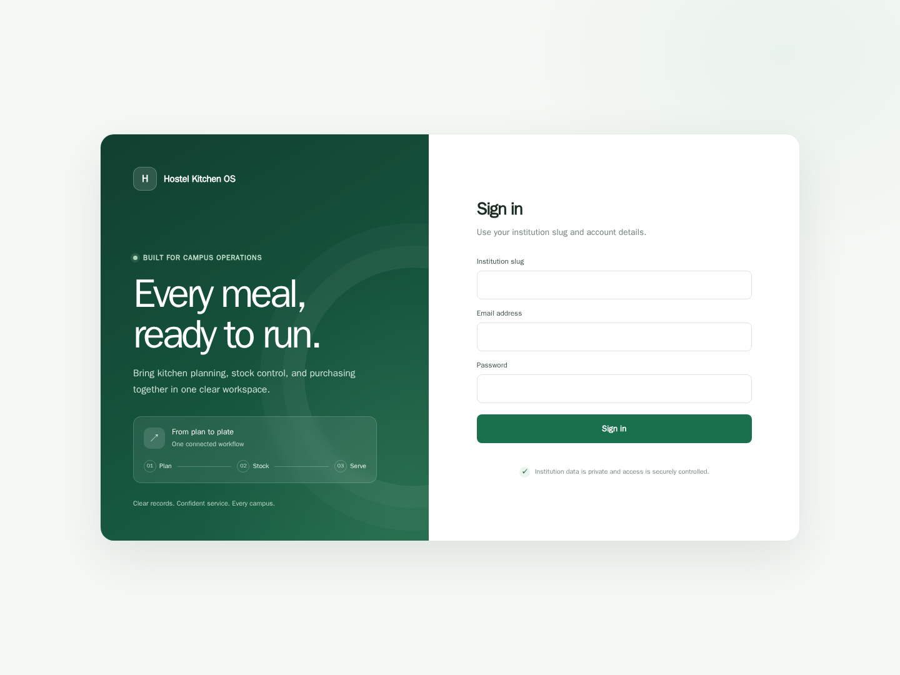

*Figure 1. Desktop sign-in page.*

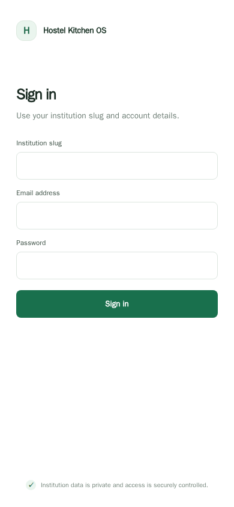

*Figure 2. Responsive sign-in page at a 390-pixel viewport.*

After authentication, the dashboard summarizes live stock positions, reorder and expiry alerts, recent stock activity, and next-step links. Selecting a metric or action opens the associated workflow.

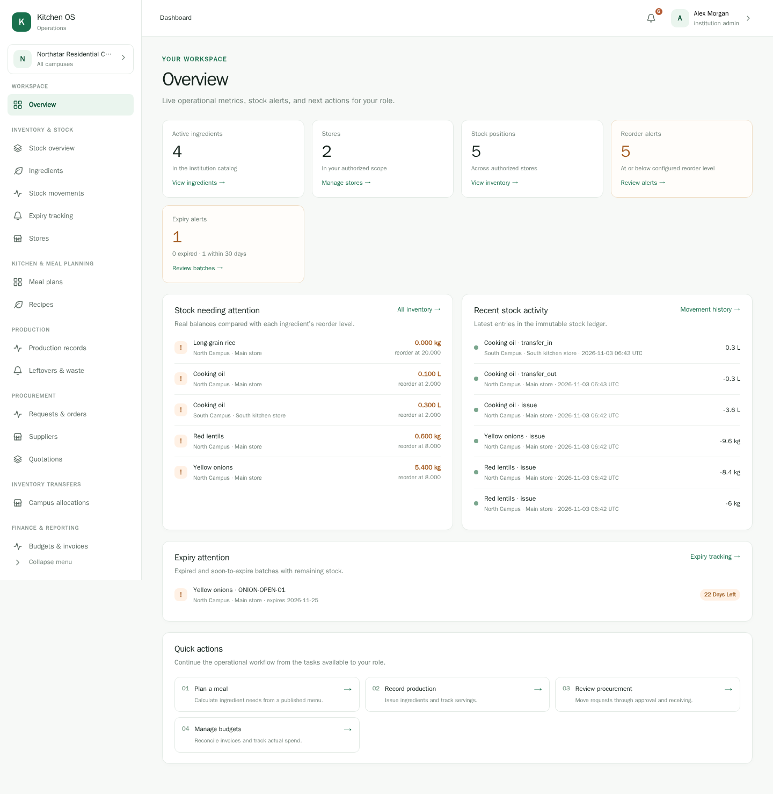

*Figure 3. Institution overview with live inventory alerts and workflow links.*

## Kitchen planning and stock availability

1. Add ingredients to the institution catalog and receive stock into a campus store. Receipts create batches; issues use eligible batches in earliest-expiry-first order and update the balance, movement ledger, and audit history together.
2. Create a versioned recipe with its serving yield, then schedule a campus meal plan using that recipe version and a planned serving count.
3. Open the plan to compare calculated ingredient demand with current eligible campus stock. The example below is a **current-stock snapshot after the sample production run**; it shows the remaining quantities needed for another service.

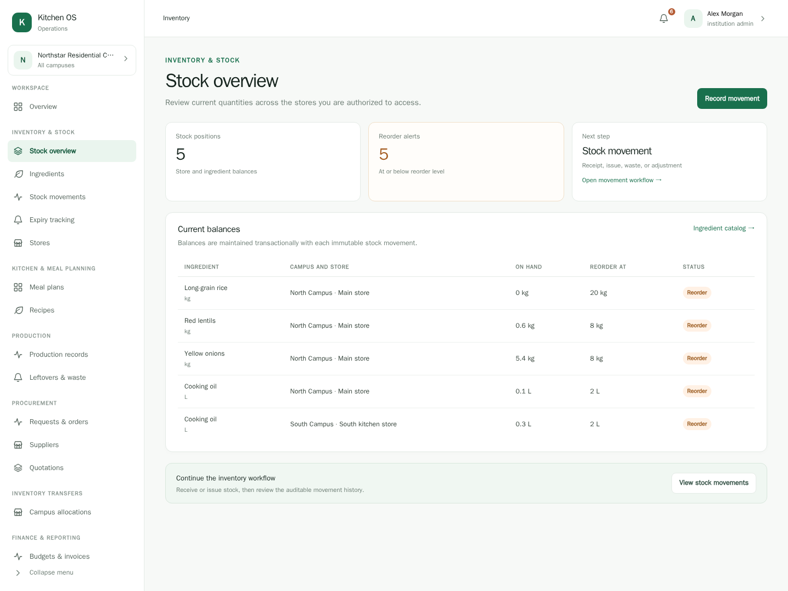

*Figure 4. Stock overview, reorder attention, expiry tracking, and recent movements.*

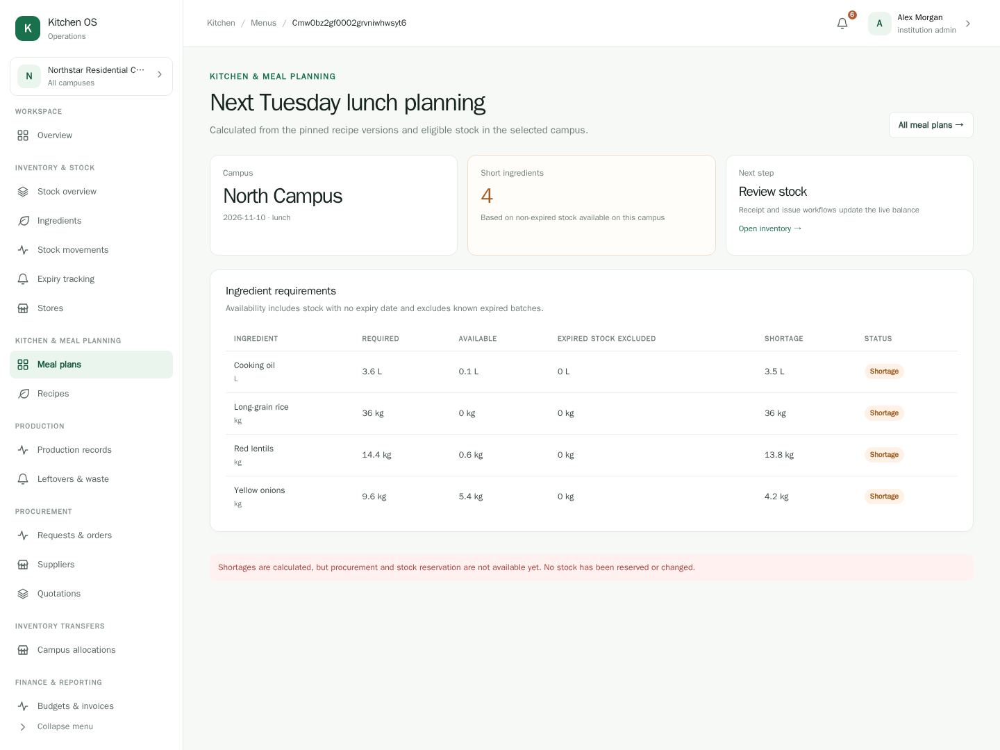

*Figure 5. Requirements are calculated from the pinned recipe version and current non-expired stock.*

Shortage calculations do not reserve stock. The page links to inventory, while a purchasing officer can move the shortage through the procurement workflow.

## Procurement, supplier comparison, and receiving

1. Create a purchase request for the campus store, add the required ingredients and quantities, then submit it for approval.
2. Record supplier quotations for the submitted request. Compare the price for every requested line and award the chosen quote; awarding creates a priced purchase order.
3. Receive the ordered quantities against that purchase order. Accepted goods update inventory batches and the stock ledger. The procurement page shows the request and order history.

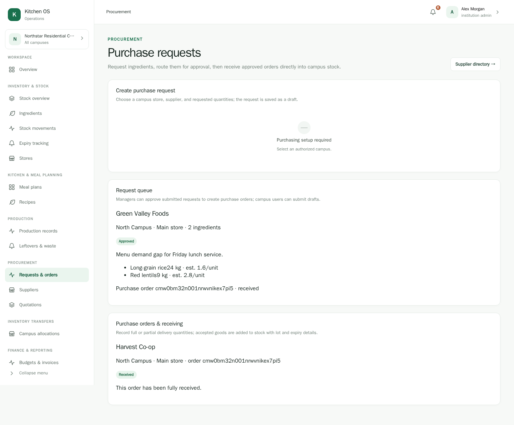

*Figure 6. Campus request and order queue after the sample purchase was received.*

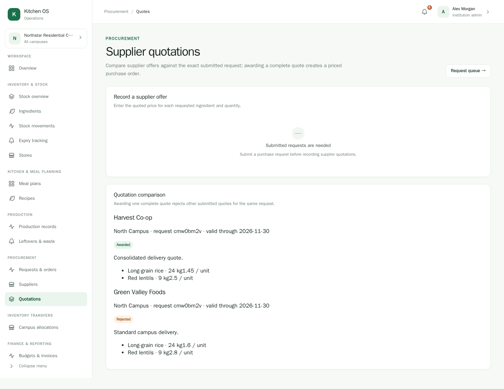

*Figure 7. Competing supplier quotes; the awarded offer created the priced order.*

## Production and waste accountability

Record prepared, served, and leftover servings against a published meal plan, with the actual ingredient quantities issued from the selected store. The issue is transactional and uses the stock-batch issue rules. Known batch costs are recorded when available; the example production cost is intentionally shown as unknown because some opening stock batches had no unit cost.

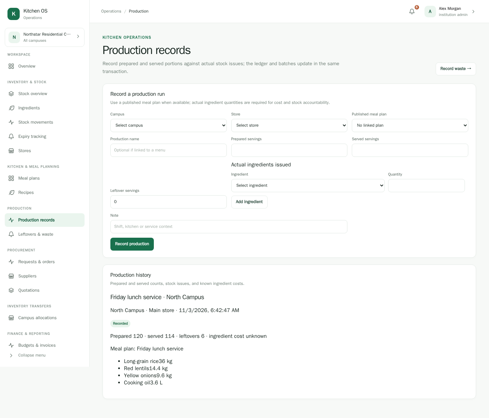

*Figure 8. Production record linked to the published lunch plan and actual stock issues.*

Record prepared-meal or leftover waste against the production run, or record raw-ingredient loss against a store. Waste records retain their reason and any calculable estimated cost.

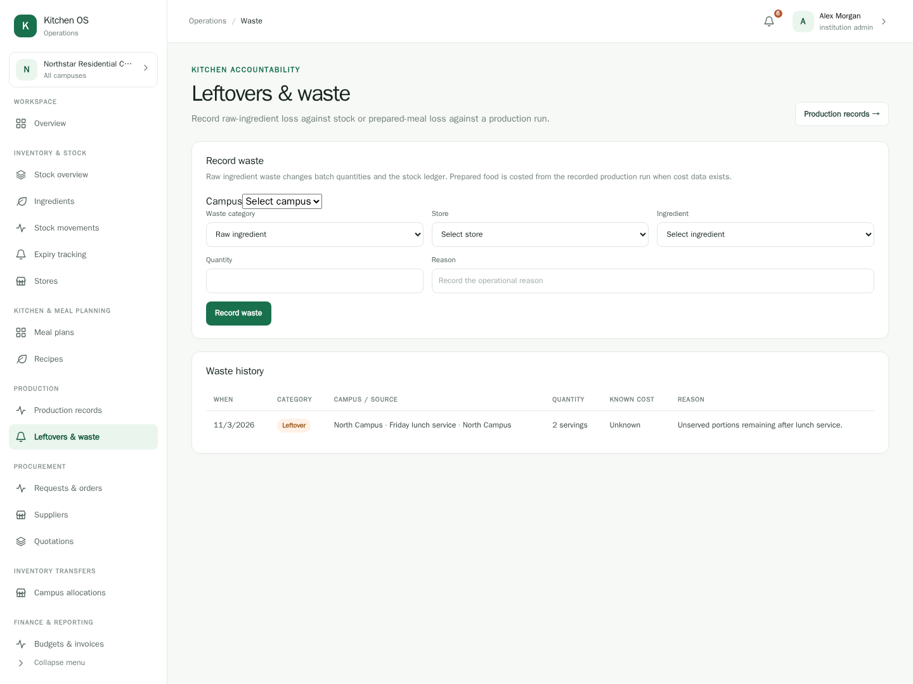

*Figure 9. Leftover servings recorded with an operational reason.*

## Campus stock transfer

Choose an origin store, destination store, and quantities to transfer. In this release, a transfer completes immediately: stock leaves the origin and arrives in destination batches in the same transaction. There is no dispatch or in-transit status.

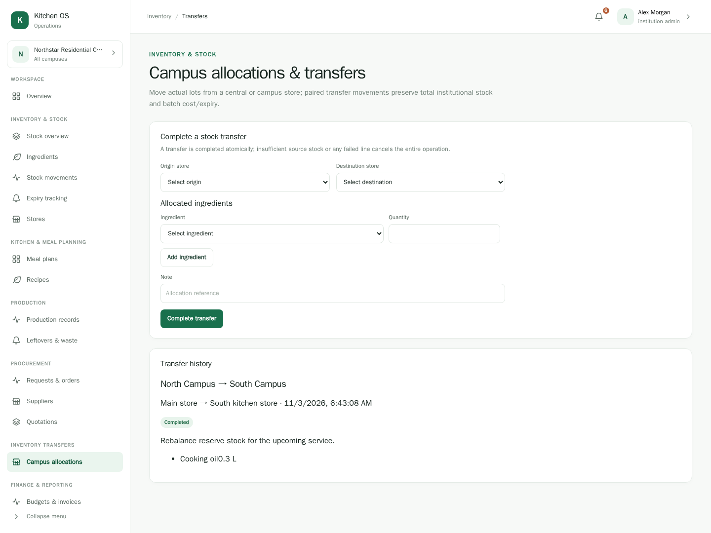

*Figure 10. Sample reserve stock moved from North Campus to South Campus.*

## Finance, reporting, and accountability

Record an invoice only after an order is fully received. Reconciliation checks the invoice amount against received quantities and agreed unit prices; reconciled invoices feed campus or institution budgets.

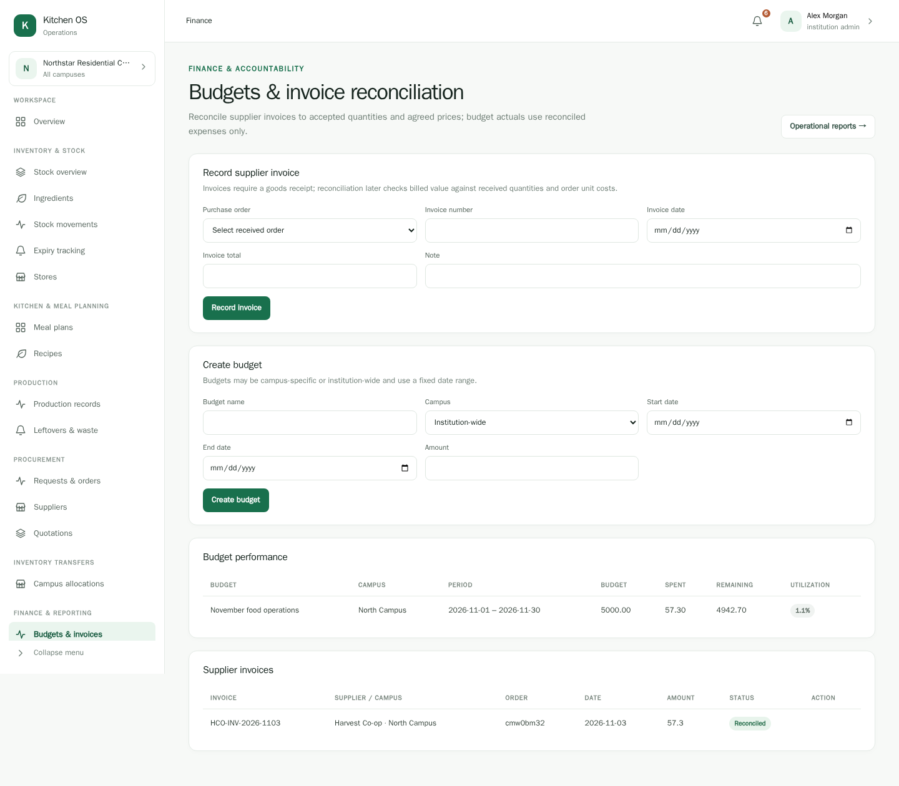

*Figure 11. Reconciled supplier invoice and budget spend in the sample period.*

Operational reports combine production, waste, reconciled spend, inventory valuation, campus comparisons, supplier performance, and a transparent recent-consumption forecast. CSV export is available from the page. The forecast is a linear planning signal, not a validated model. The integrations panel describes the API boundary; no external accounting or hostel system is connected in this example.

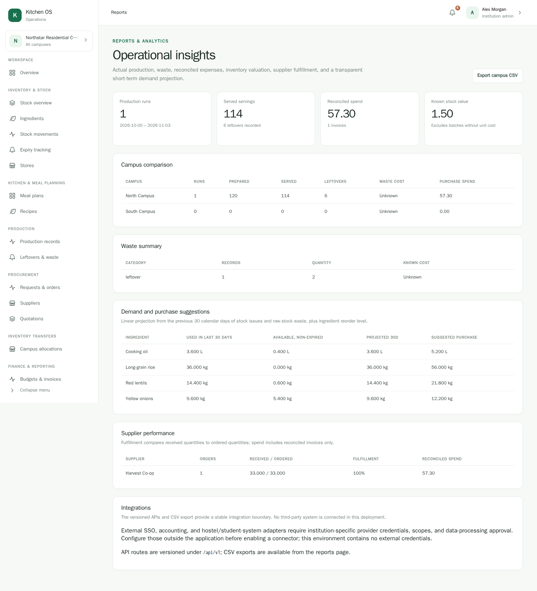

*Figure 12. Campus comparisons, spending, waste, demand suggestions, and integration status.*

The institution audit log provides an administrator-scoped view of recent operational and access events.

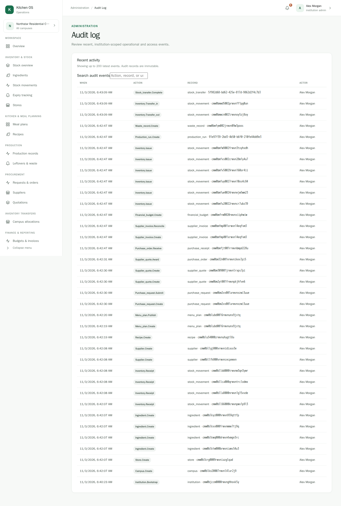

*Figure 13. Recent sample workflow events in the audit log.*

## Workflow boundaries

- The sample shows the connected path from planned demand to purchase request, quote award, receipt, production, and waste recording. Meal-plan calculations do not reserve stock or automatically create purchase requests.
- Transfers are atomic and immediate, not a multi-stage dispatch/receipt lifecycle.
- Budgets use reconciled invoices only. Taxes, payments, partial invoices, and line-level allocations are not modeled.
- External integrations require institution-specific provider selection and credentials; the screenshots do not represent a live connector.
- All sample records were created in a temporary local database for these screenshots; they are not shipped as application seed data.

